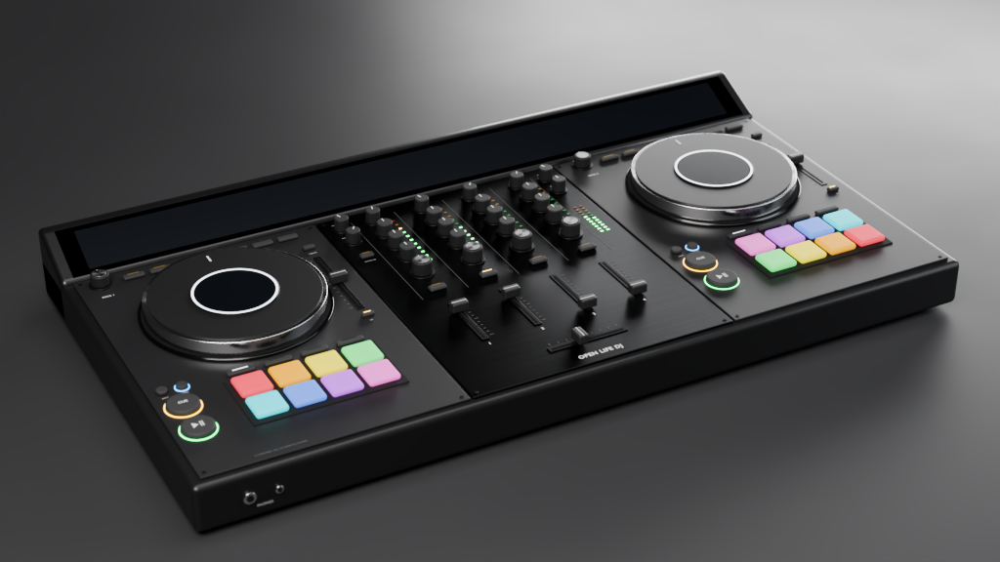

# Open Life DJ

An open-source DJ application whose interface is a hyperrealistic 4-channel all-in-one DJ system, modelled in Blender and brought to life in C++.

> **Status:** Milestone 0 (foundation). The app opens a window showing the controller render and plays a test tone through your audio device. See [ROADMAP.md](ROADMAP.md).



## Building

Requirements: CMake ≥ 3.22, Ninja, and a C++20 compiler (Xcode Command Line Tools on macOS, Visual Studio 2022 on Windows, GCC/Clang on Linux).

```bash
git clone --recurse-submodules <repo-url>
cd open-life-dj
cmake --preset dev
cmake --build --preset dev
ctest --preset dev
```

The app is built at `build/dev/app/OpenLifeDJ_artefacts/Debug/Open Life DJ.app` (macOS). On Linux, install the packages listed in [`.github/workflows/ci.yml`](.github/workflows/ci.yml) first.

For debugging and profiling on macOS: `cmake --preset xcode`, then open `build/xcode/OpenLifeDJ.xcodeproj`.

## Repository layout

| Path | What |
|---|---|
| `engine/` | Audio engine. No GUI dependencies; real-time safe (see `engine/include/oldj/Engine.h`) |
| `app/` | JUCE desktop app: window, audio device, UI |
| `tests/` | Engine unit tests (Catch2) |
| `assets/` | Images generated from Blender, embedded in the app |
| `blender/` | Scripts that build and render the controller (`build_controller.py`, `render_final.py`, `export_app_background.py`) |
| `external/JUCE` | JUCE 9 (git submodule) |

## Licence

- **Code:** [GNU AGPLv3](LICENSE). Open Life DJ uses [JUCE](https://juce.com) under its AGPLv3 option.
- **Artwork** (Blender models, renders, UI images): licence to be decided before the first public release (CC BY-SA 4.0 is the candidate).
- **Name and logo:** "Open Life DJ" and its logo are not covered by the code licence. Forks must use a different name.
